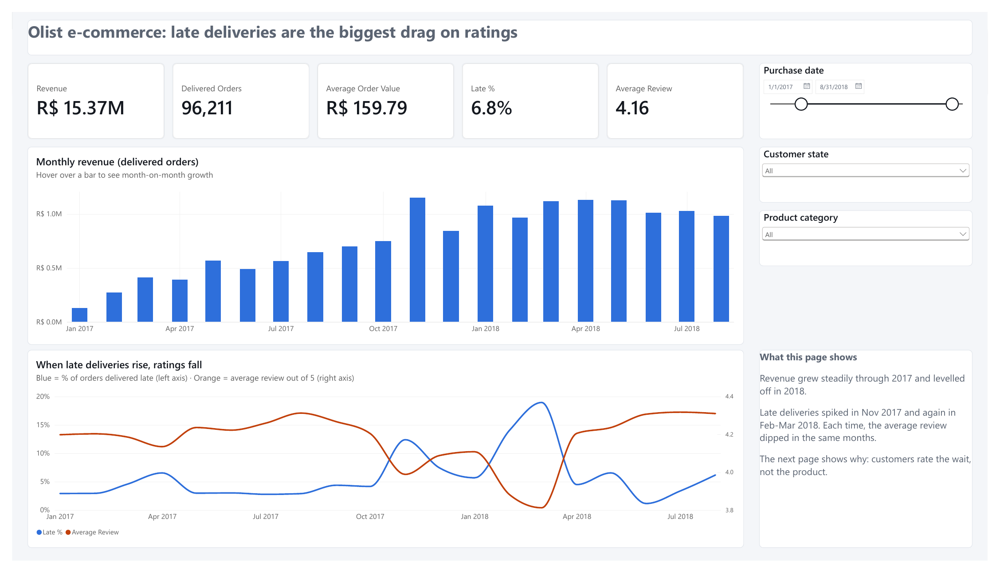

# Olist E-Commerce BI: Python Business Intelligence Project

🔴 **Live dashboard: [olist-bi-shykeys.streamlit.app](https://olist-bi-shykeys.streamlit.app)**

An end-to-end BI project on **~100,000 real orders** from Olist, Brazil's largest department-store marketplace. It takes the data from raw CSV files to a validated star schema, KPIs, customer analysis and an interactive dashboard, using only Python.

**Tools:** Python · pandas · SQL (DuckDB) · SciPy · Plotly · Streamlit · Power BI (DAX) · Google Colab

---

## Business questions
1. How is revenue growing, and which categories and regions drive it?
2. How many customers come back, and which customer segments are the most valuable?
3. Is delivery performance hurting customer satisfaction?
4. What should the business do about it?

## Project roadmap

| Week | Stage | Status |
|---|---|---|
| 1 | Data pipeline & star schema | ✅ Done |
| 2 | KPIs, cohort retention, RFM segmentation | ✅ Done |
| 3 | Interactive Streamlit dashboard ([live link](https://olist-bi-shykeys.streamlit.app)) | ✅ Done |
| 4 | Power BI executive report & recommendations | ✅ Done |

## Week 1: Data pipeline & star schema
📓 [`notebooks/01_data_pipeline_star_schema.ipynb`](notebooks/01_data_pipeline_star_schema.ipynb)

Turned **9 linked raw tables** into a clean **star schema**:

```
                 dim_date
                    │
 dim_customer ── fact_orders ── fact_order_items ── dim_product
                                       │
                                   dim_seller
```

**Data-quality issues found and fixed:**
- **Duplicate and repeat reviews**: kept one review per order (the latest)
- **GPS points outside Brazil**: removed, then averaged to one point per zip code
- **Customer ID changes with every order**: modelled customers on `customer_unique_id`, so repeat buyers aren't miscounted as new ones
- **Missing and untranslated product categories**: filled in and translated to English
- **Misspelled column names** in the source (`lenght`): standardised

**Automated validation:** 14 checks confirm that every table has one row per key, no rows were lost, revenue reconciles to the cent, and every foreign key matches its dimension.

**Week 1 headline numbers:**

| Metric | Value |
|---|---|
| Orders | 99,441 |
| Real customers | 96,096 |
| Sellers / Products | 3,095 / 32,951 |
| Revenue, delivered orders | R$ 15.42M |
| Average order value | R$ 159.83 |
| Delivered late | 6.8% |
| Average review score | 4.16 / 5 |
| Customers who ordered more than once | **3.1%** |

## Week 2: KPIs, retention & customer segments
📓 [`notebooks/02_kpis_retention_segments.ipynb`](notebooks/02_kpis_retention_segments.ipynb)

**What I did:** a monthly KPI layer in SQL, cohort retention analysis, RFM segmentation into 7 action-ready segments, and hypothesis tests (Mann-Whitney U, chi-square) on delivery performance.

**Key findings (after quality checks):**
- **Olist is a one-time-purchase business:** only **2.2%** of customers came back on a different day. (28% of apparent "repeat" customers had just split one shopping trip into several orders the same day.)
- **Real repeat buyers take time:** median **74 days** to a 2nd purchase; **30%** return within 30 days.
- **Missing the promised date is what triggers 1-star reviews:** late orders average **2.27★ vs 4.29★** on time, but **75%** of late-order reviews were written *before the parcel arrived*. Among reviews written after delivery, the gap is smaller but still clear: **3.53★ vs 4.29★** (effect size r = 0.30, p < 0.001).
- **Late first order vs coming back:** customers with a late first order returned less (**1.57% vs 2.02%** within 180 days), but the difference is **not statistically significant** once cohort timing is controlled for (Mantel-Haenszel OR = 0.81, p = 0.12).
- **Slower states get worse reviews:** across the 21 states with 300+ orders, delivery time and average review are strongly linked (Spearman r = **−0.84**, p < 0.001).
- **Revenue is concentrated:** SP, RJ and MG make up **62%** of revenue; Health & Beauty is the top category (9.2%).

**Quality checks:** 7 checks (split orders, equal observation windows, cohort timing, review timing, effect sizes, small-state bias, reconciliation) — all reconciliation checks pass, and two original findings were revised.

## Week 3: Interactive dashboard
🔴 **Live:** [olist-bi-shykeys.streamlit.app](https://olist-bi-shykeys.streamlit.app) · 📂 [`dashboard/`](dashboard/)

A Streamlit app that downloads the data from Kaggle, rebuilds the same star schema and runs the same integrity checks, then serves it as an interactive dashboard:
- **Filters:** purchase month, customer state and product category
- **KPI tiles:** revenue, delivered orders, average order value, late %, average review
- **Overview:** monthly revenue, late-delivery rate and review score
- **Delivery & reviews:** review score by delivery timing, with a toggle to count only reviews written after the parcel arrived, plus delivery time vs reviews by state
- **Customers:** cohort retention heatmap, repeat-purchase windows and RFM segments with suggested actions (using the quality-checked definitions from Week 2.1)
- **Regions & categories:** top states and categories by revenue

**Cross-checked against the notebooks:** revenue, AOV (R$ 159.79), late rate (6.8%), average review (4.16), 2.2% repeat customers, 74-day median gap and the review-by-timing table all match.

## Week 4: Power BI executive report & recommendations
📊 [`powerbi/olist.pbix`](powerbi/olist.pbix) · 📄 [PDF](powerbi/olist_executive_report.pdf) · 📓 [`notebooks/03_powerbi_export.ipynb`](notebooks/03_powerbi_export.ipynb)

Python prepares the data; Power BI does the business reporting. The export notebook turns the quality-checked model into 7 CSV tables (10 checks before export). In Power BI Desktop: a star schema with 5 relationships, 20+ DAX measures ([`measures.dax`](powerbi/measures.dax)), a custom theme and 4 report pages:

| Page | Headline |
|---|---|
| Overview | Late deliveries are the biggest drag on ratings |
| Delivery & reviews | Customers rate the wait, not the product |
| Customers | Olist is a one-purchase business |
| Recommendations | Fix delivery promises first, then build repeat purchases |



**Recommendations** (full write-up: [`EXECUTIVE_SUMMARY.md`](powerbi/EXECUTIVE_SUMMARY.md)):
1. Set honest delivery dates by region, and send review requests after delivery, not around the promised date.
2. Warn customers early when a parcel is running late.
3. Build a second-purchase programme in the first 30–60 days, starting with *New big spenders*; track repeat rate (2.2% today) as the main growth KPI.
4. Protect delivery reliability in SP, RJ and MG (62.5% of revenue) before expanding in slower regions.

**QC:** every card was checked against the notebooks and the live dashboard (revenue R$ 15.37M for Jan 2017–Aug 2018, AOV R$ 159.79, late 6.8%, review 4.16, 94,990 customers, 2.2% repeat, 74% of late-order reviews written before arrival). One DAX bug was caught along the way: `= 0` also matches blanks in DAX, which inflated the "before arrival" share to 77%; a strict `== 0` fixed it.

## How to run
**Notebooks:**
1. Open the notebook in Google Colab.
2. Add your Kaggle credentials in **Secrets** (🔑) as `KAGGLE_API_TOKEN`.
3. Click **Runtime → Run all**. The data downloads automatically.

**Power BI:** run `notebooks/03_powerbi_export.ipynb` in Colab, then follow [`powerbi/BUILD_GUIDE.md`](powerbi/BUILD_GUIDE.md), or open `powerbi/olist.pbix` in Power BI Desktop.

**Dashboard locally:** `pip install -r dashboard/requirements.txt`, put `KAGGLE_API_TOKEN = "..."` in `.streamlit/secrets.toml`, then `streamlit run dashboard/app.py`.

## Data source
[Brazilian E-Commerce Public Dataset by Olist](https://www.kaggle.com/datasets/olistbr/brazilian-ecommerce) on Kaggle (CC BY-NC-SA 4.0). The raw data is not stored in this repo; the notebook downloads it.

---
👤 **Oluwaseyi**: Community Manager & Business Development, building data and BI skills · [LinkedIn](https://www.linkedin.com/in/oluwaseyi-o-601915b5/)
